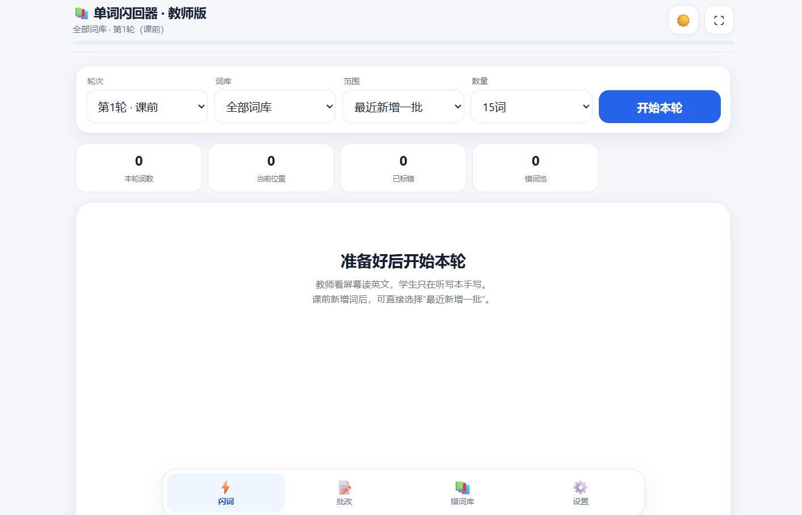
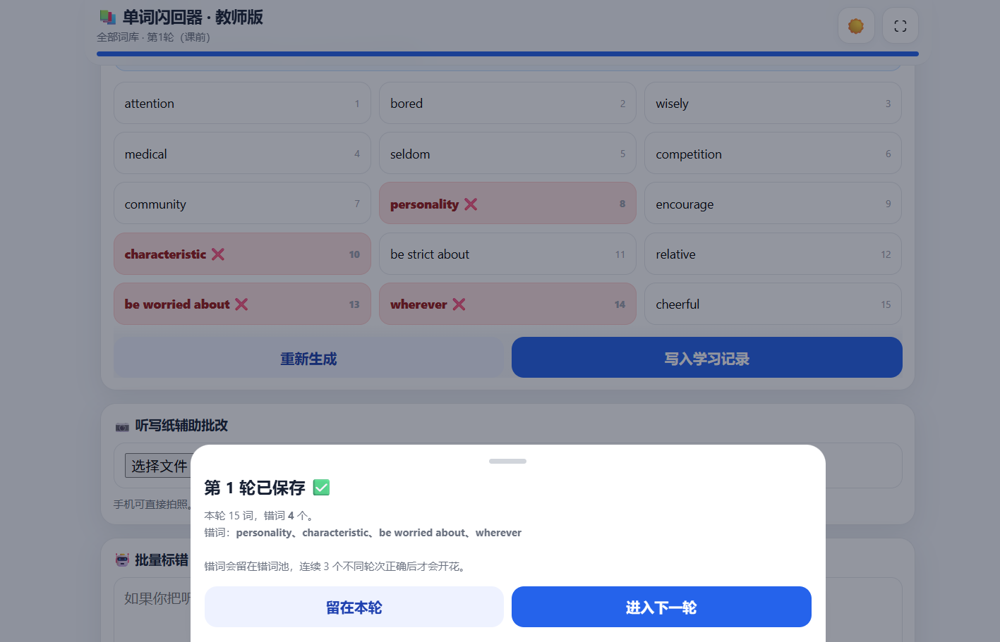

# English Flashback
### AI-Assisted Vocabulary Practice & Error Tracking Tool

An interactive, mobile-friendly vocabulary learning tool designed to support structured English dictation, error tracking, and personalized revision.

**[Live Demo](https://134130yg.github.io/english-flash/)** | **[GitHub Repository](https://github.com/134130yg/english-flash)**

## Product Screenshots | 产品界面展示

| Session Setup | Vocabulary Flashcard | Error Tracking |
|:---:|:---:|:---:|
|  |  |  |
| 听写配置与开始 | 互动词卡与学习操作 | 错词记录与针对性复习 |

*Screenshots captured from the actual V4 web application. Demonstration records are used where applicable.*

## 01. Project Overview | 项目背景

English Flashback is an independent educational product project developed from real-world one-on-one English tutoring experience.

Traditional vocabulary dictation often relies on paper-based tests and manual correction. While this approach helps teachers identify mistakes, tracking repeated errors and organizing targeted revision across multiple lessons can be time-consuming.

This project explores how a lightweight digital tool can simplify vocabulary management, support structured dictation sessions, and make learning progress easier to track.

本项目源于真实的初中英语家教场景，针对传统听写过程中词汇管理繁琐、错词反复出现、复习安排缺乏连续记录等问题，设计并开发了一款移动端网页工具。

## 02. Target Users | 目标用户

**Primary User:** English tutors and teachers conducting vocabulary dictation sessions.

**Learning Participant:** Middle school students who need repeated vocabulary practice and targeted revision.

The current version follows a teacher-guided workflow: teachers manage vocabulary and record results through the web interface, while students complete dictation exercises on paper.

## 03. Core Features | 核心功能

| Feature | Description |
|---|---|
| Vocabulary Management | Manage built-in and custom vocabulary lists, organized by learning units and difficulty levels. |
| Multi-Round Dictation | Organize vocabulary practice into pre-class, in-class, post-class and revision sessions. |
| Error Tracking | Record incorrectly written words and maintain a review pool. |
| Learning Progress | Track attempts, correct answers, mistakes and mastery indicators. |
| Flexible Practice | Select recently added words, previous mistakes or priority vocabulary for targeted revision. |
| Data Management | Export CSV learning records and back up or restore data in JSON format. |

The tool also supports browser-based word pronunciation and optional batch error marking using externally prepared word lists.

## 04. Product Workflow | 使用流程

**Select Vocabulary → Start Dictation → Mark Errors → Save Results → Review Mistakes**

1. Select a vocabulary unit, practice round and word range.
2. Start a dictation session using interactive word cards.
3. Mark incorrect words after checking students' written answers.
4. Save the session to update learning records.
5. Revisit previously incorrect words in subsequent practice rounds.

## 05. Product Iteration | 版本迭代

**V3 — Core Teaching Workflow**

Established the mobile-friendly dictation interface, manual error marking, vocabulary review, and local learning records.

**V4 — Flexible Vocabulary Management**

Expanded batch vocabulary entry, recently added vocabulary selection, and vocabulary library management to accommodate changing teaching materials and lesson requirements.

Version history is available through the repository's GitHub commit records.

## 06. AI-Assisted Development | AI应用实践

Generative AI was used as a development support tool during the project, assisting with frontend implementation and iterative problem-solving.

The project combines real teaching needs, product workflow design, AI-assisted implementation, and practical testing.

**Important distinction:** The current website is not an AI-powered automatic grading system. Teachers remain responsible for reviewing handwritten answers. External AI tools may optionally assist with identifying error words, which can then be imported for batch marking.

## 07. Technology & Data

**Technology:** HTML, CSS, JavaScript, GitHub Pages.

**Data Storage:** Browser localStorage, with CSV export and JSON backup/restore.

**Deployment:** Public static website accessible through desktop and mobile browsers.

No user account registration or cloud-based learning record synchronization is implemented in the current version.

## 08. Product Roadmap | 后续优化方向

- Improve first-time user onboarding and empty-state guidance.
- Refine vocabulary mastery rules and review logic.
- Conduct structured usability testing and document user feedback.
- Explore more independent student practice experiences.

---

### 中文项目简介

English Flashback是一款基于真实初中英语教学场景开发的词汇训练工具。项目围绕词库管理、分轮听写、错词记录及针对性复习等需求，利用AI辅助网页开发，将传统纸质听写过程中的管理与记录环节数字化。

项目采用轻量级网页形式，支持移动设备使用，并通过GitHub Pages公开部署。当前版本以教师操作为主，学生参与纸质听写，支持本地学习记录保存、数据导出及备份恢复。

本项目主要展示需求识别、教学流程设计、AI辅助工具开发、产品功能迭代及用户体验优化能力。
